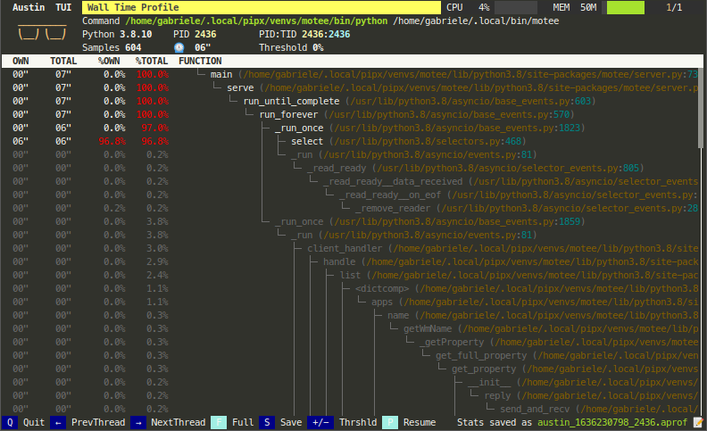

<h3 align="center">A Frame Stack Sampler for CPython</h3>

  
  &nbsp;&nbsp;&nbsp;&nbsp;
  
  &nbsp;&nbsp;&nbsp;&nbsp;
  

  
  
  
  
  

   
  
  
  
  <!--  -->
  
  

  

  <a href="https://p403n1x87.github.io/austin/"><b>Documentation</b></a>&nbsp;&bull;
  <a href="#synopsis"><b>Synopsis</b></a>&nbsp;&bull;
  <a href="#installation"><b>Installation</b></a>&nbsp;&bull;
  <a href="#usage"><b>Usage</b></a>&nbsp;&bull;
  <a href="#compatibility"><b>Compatibility</b></a>&nbsp;&bull;
  <a href="#contribute"><b>Contribute</b></a>

  

----

<i>This is the nicest profiler I’ve found for Python. It’s
cross-platform, doesn’t need me to change the code that’s being profiled, and
its output can be piped directly into <code>flamegraph.pl</code>. I just used it
to pinpoint a gross misuse of SQLAlchemy at work that’s run in some code at the
end of each day, and now I can go home earlier.</i>  -- gthm on <a
href="https://lobste.rs/s/qairy5/austin_python_frame_stack_sampler_for">lobste.rs</a>

<i>If people are looking for a profiler, Austin looks pretty
cool. Check it out!</i>  -- Michael Kennedy on <a
href="https://www.youtube.com/watch?v=eFgybynhMrs">Python Bytes 180</a>

 <a href="https://twitter.com/AustinSampler">Follow  on </a>

----

# Synopsis

Austin is a Python frame stack sampler for CPython written in pure C. Samples
are collected by reading the CPython interpreter virtual memory space to
retrieve information about the currently running threads along with the stack of
the frames that are being executed. Hence, one can use Austin to easily make
powerful statistical profilers that have minimal impact on the target
application and that don't require any instrumentation.

The key features of Austin are:
- Zero instrumentation;
- Minimal impact;
- Fast and lightweight;
- Time and memory profiling;
- Built-in support for multi-process applications (e.g. `mod_wsgi`).

The simplest way to turn Austin into a full-fledged profiler is to use together
with the [VS
Code](https://marketplace.visualstudio.com/items?itemName=p403n1x87.austin-vscode)
extension or combine it with [FlameGraph] or [Speedscope]. However, Austin's
binary output can be piped into any other external or custom tools for further
processing. Look, for instance, at the following Python TUI

  

Check out [A Survey of Open-Source Python
Profilers](https://www.usenix.org/system/files/login/articles/login_winter19_12_norton.pdf)
by Peter Norton for a general overview of Austin.

Check out the [documentation] for more tool ideas and examples!

---

💜 <i>Austin is a free and open-source project. A lot of
effort goes into its development to ensure the best performance and that it
stays up-to-date with the latest Python releases. If you find it useful,
consider <a href="https://github.com/sponsors/P403n1x87">sponsoring</a> this
project.</i> 🙏

---

# Documentation

The full documentation, with one version for each Austin minor release, is available
at <https://p403n1x87.github.io/austin/>. It covers

- the complete [installation] instructions for every platform;
- the [command line options][usage] and environment variables;
- the [features] of Austin, like memory profiling, native frame stacks and
  `asyncio` support;
- [platform-specific details][compatibility], e.g. permissions on Linux and
  macOS;
- the [ecosystem] of tools built around Austin;
- the specification of the [MOJO] binary format.

# Installation

Austin is available from [PyPI][pypi] and from the major software repositories
of the most popular platforms

| Platform            | Command                                          |
| ------------------- | ------------------------------------------------ |
| Any (PyPI)          | `pip install austin-dist`                        |
| Linux (Snap)        | `sudo snap install austin --classic`             |
| Debian/Ubuntu       | `sudo apt install austin`                        |
| macOS               | `brew install austin`                            |
| Windows             | `choco install austin` or `scoop install austin` |
| Linux/macOS (Conda) | `conda install -c conda-forge austin`            |

Pre-compiled binaries and installers are available from the [latest release]
page. See the [installation] page for how to build Austin from sources.

# Usage

To profile a Python script, run

~~~ console
austin -o profile.mojo python myscript.py
~~~

To profile a running Python application, attach Austin to it with

~~~ console
austin -o profile.mojo -p <pid>
~~~

Austin writes its samples in the binary [MOJO] format. The recommended way to
visualise them is with the [Austin VS Code extension], which opens `.mojo` files
directly. The [`austin-python`] package provides tools to convert them to other
formats, like the collapsed stacks used by [FlameGraph], or [Speedscope].

The [usage] page describes all the command line options, and the [features]
page covers each of them in detail.

# Compatibility

Austin runs on Linux, macOS and Windows. The [compatibility] page lists the
supported Python versions and architectures for each release, and the
platform-specific details to be aware of.

# Why Austin

Austin is written in pure C, has no dependencies beyond the standard C library,
and is just a sampler, so it can sample at very high rates with minimal impact
on the target application. Read more about [why Austin][why austin] in the
documentation.

# Examples

See the [examples] in the documentation, and the [ecosystem] page for the tools
that build on Austin.

# Contribute

If you like Austin and you find it useful, there are ways for you to contribute.

If you want to help with the development, then have a look at the open issues
and have a look at the [contributing guidelines](CONTRIBUTING.md) before you
open a pull request.

You can also contribute to the development of the Austin by becoming a sponsor
and/or by [buying me a coffee](https://www.buymeacoffee.com/Q9C1Hnm28) on BMC or
by chipping in a few pennies on [PayPal.Me](https://www.paypal.me/gtornetta/1).

  

----

  <a href="https://twitter.com/AustinSampler">
    Follow  on 
  </a>

[examples]: https://p403n1x87.github.io/austin/latest/usage/#examples
[Austin VS Code extension]: https://marketplace.visualstudio.com/items?itemName=p403n1x87.austin-vscode
[`austin-python`]: https://github.com/P403n1x87/austin-python
[compatibility]: https://p403n1x87.github.io/austin/latest/compatibility/
[documentation]: https://p403n1x87.github.io/austin/
[ecosystem]: https://p403n1x87.github.io/austin/latest/ecosystem/
[features]: https://p403n1x87.github.io/austin/latest/features/
[FlameGraph]: https://github.com/brendangregg/FlameGraph
[installation]: https://p403n1x87.github.io/austin/latest/installation/
[latest release]: https://github.com/P403n1x87/austin/releases/latest
[MOJO]: https://p403n1x87.github.io/austin/latest/formats/mojo/
[pypi]: https://pypi.org/project/austin-dist/
[Speedscope]: https://speedscope.app
[usage]: https://p403n1x87.github.io/austin/latest/usage/
[why austin]: https://p403n1x87.github.io/austin/latest/#why-austin
